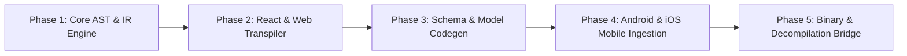

# ROADMAP: Flutterin Delivery Milestones

> **Master Product Roadmap (Pillar: 01_Product)**
> Phased capabilities and engineering milestones for the Flutterin conversion engine.

---

## 1. Milestone Horizon

---

## 2. Phase Breakdown

### Phase 1: Core AST & IR Engine (Foundation)
- [x] TypeScript / Node.js project architecture definition.
- [x] `.agents` autonomous governance and verification gates.
- [ ] Define Unified Widget Intermediate Representation (`UnifiedWidgetNode`, `UnifiedLayoutNode`, `UnifiedStyleMap`).
- [ ] Dart Code Emitter with strict formatting and syntax validation.

### Phase 2: React & Web Transpiler (`flutterin_convert_react`, `flutterin_convert_web`)
- [ ] JSX/TSX Babel AST traversal for HTML & React components.
- [ ] Tailwind CSS & CSS utility mapper to Flutter `BoxDecoration`, `EdgeInsets`, and `TextStyle`.
- [ ] Flexbox to `Row`, `Column`, `Flex`, `Wrap`, `Expanded`, `Spacer` mapping.
- [ ] Form and Input handling (`input` -> `TextFormField`, `button` -> `ElevatedButton`/`FilledButton`).

### Phase 3: Schema & Model Codegen (`flutterin_generate_models`)
- [ ] JSON payload and OpenAPI/JSON Schema parser.
- [ ] Emits Freezed 2.x immutable classes with `@freezed` and `json_serializable`.
- [ ] Riverpod repository and API service generation (`dio` / `http` client wrappers).

### Phase 4: Native Mobile Ingestion (`flutterin_convert_android`, `flutterin_convert_ios`)
- [ ] Android XML Layout parser -> Flutter Widget Tree.
- [ ] Jetpack Compose Composable function analysis -> Flutter Stateless/ConsumerWidget.
- [ ] iOS SwiftUI View analysis -> Flutter declarative widgets.

### Phase 5: Binary & Decompilation Bridge (`flutterin_analyze_binary`)
- [ ] Integration with binary analysis and AOT deconstruction routines.
- [ ] Extraction of layout trees, string tables, and logic signatures from compiled packages.
- [ ] Clean-room reconstruction to pure Dart source code.
