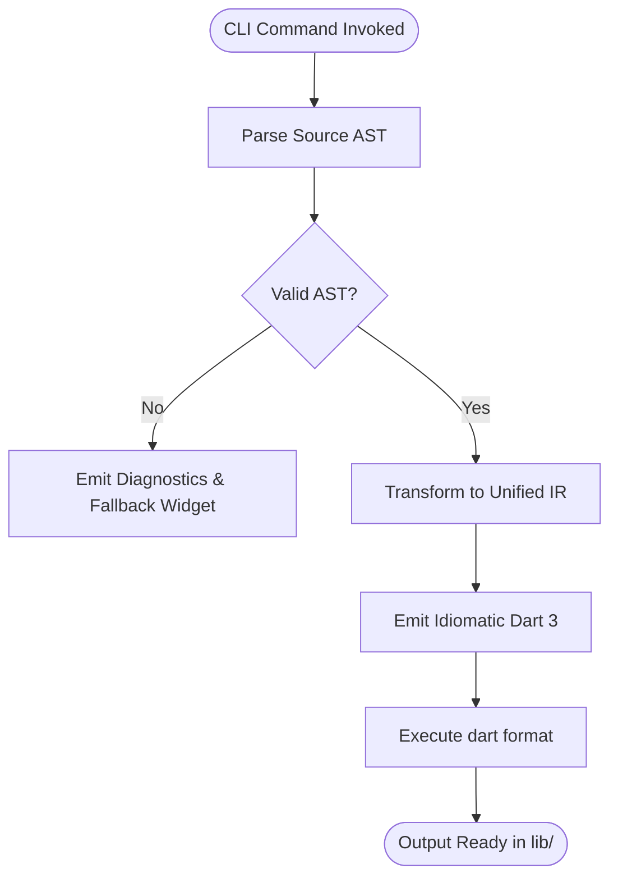

# UX Navigation Flows & Screen Hierarchy

<!-- [FLUTTERIN:AUTO-INFERRED:START source="flutterin-engine" confidence="AST_VERIFIED"] -->
## Operational User Journeys

<!-- [FLUTTERIN:AUTO-INFERRED:END] -->

<!-- Manual developer notes outside comment anchors are 100% PRESERVED across re-scans -->
## Manual Architecture & Business Decisions
- (Add custom domain notes here)
