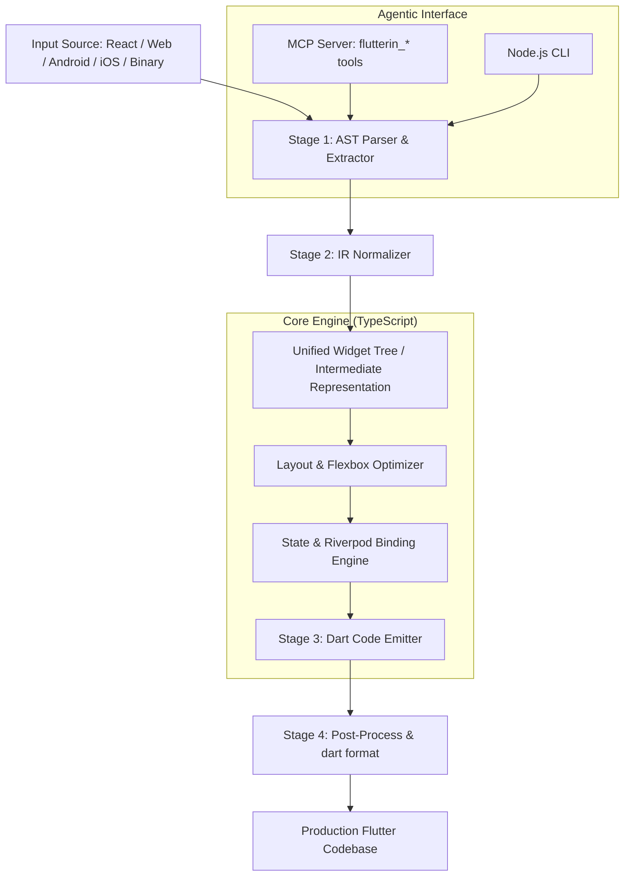

# ARCHITECTURE: Flutterin Engine

> **Master Technical Atlas (Pillar: 03_Tech)**
> Technical architecture of the Flutterin transpiler and MCP conversion pipeline.

---

## 1. High-Level System Architecture

`flutterin` is constructed as a modular Node.js/TypeScript pipeline with a 4-stage transformation engine:

---

## 2. Core System Components

### A. The Ingestion & Parser Layer (`src/parsers/`)
- **React / Web Parser**: Uses Babel AST (`@babel/parser`, `@babel/traverse`) to extract JSX component hierarchies, props, and Tailwind/inline CSS style properties.
- **Android Parser**: Analyzes Android XML layouts (`ConstraintLayout`, `LinearLayout`, `FrameLayout`) and Jetpack Compose composables into semantic layout primitives.
- **iOS Parser**: Analyzes SwiftUI View bodies and Storyboard XML into declarative structures.
- **Binary & AOT Extractor**: Deconstructs compiled assets and extracts string tables, API schemas, and widget metadata.

### B. Intermediate Representation (`src/ir/`)
- `UnifiedWidgetNode`: Universal representation of a UI component with attributes, children, event listeners, and style rules.
- `UnifiedLayoutNode`: Normalizes Flexbox, Absolute, Relative, and Grid layouts into Flutter-equivalent constraints (`Row`, `Column`, `Stack`, `GridView`).
- `UnifiedStyleMap`: Resolves CSS/XML styling attributes into Dart `BoxDecoration`, `TextStyle`, `EdgeInsets`, and `BorderRadius`.

### C. Codegen & Dart Emitter (`src/codegen/`)
- Generates pure Dart 3.x source files.
- Emits `@freezed` and `json_serializable` data classes.
- Generates Riverpod 2.x `AsyncNotifier` and `Notifier` state providers.
- Executes `dart format` to ensure zero syntax or formatting defects.

### D. MCP Server Integration (`src/mcp/`)
Exposes the tool protocol directly to AI agents:
- `flutterin_doctor`: Diagnoses workspace setup, Dart SDK, and converter dependencies.
- `flutterin_convert_react`: Converts React JSX/TSX files and component trees to Flutter widgets.
- `flutterin_convert_web`: Converts raw HTML/CSS/Tailwind snippets into Flutter widgets.
- `flutterin_convert_android`: Converts Android XML or Compose into Flutter widgets.
- `flutterin_convert_ios`: Converts SwiftUI / UIKit structures to Flutter.
- `flutterin_generate_models`: Emits Freezed Dart models from JSON/OpenAPI specs.
- `flutterin_analyze_binary`: Analyzes compiled APK/IPA/WebAssembly binaries for Flutter reconstruction.

---

## 3. Technology Stack

- **Runtime**: Node.js 20+ / TypeScript 5.x.
- **AST Libraries**: `@babel/parser`, `@babel/traverse`, `tree-sitter`.
- **Target Platform**: Flutter 3.x / Dart 3.x.
- **Quality Gates**: Vitest for unit tests, Orion CLI (`verify_agents`) for agentic compliance.
